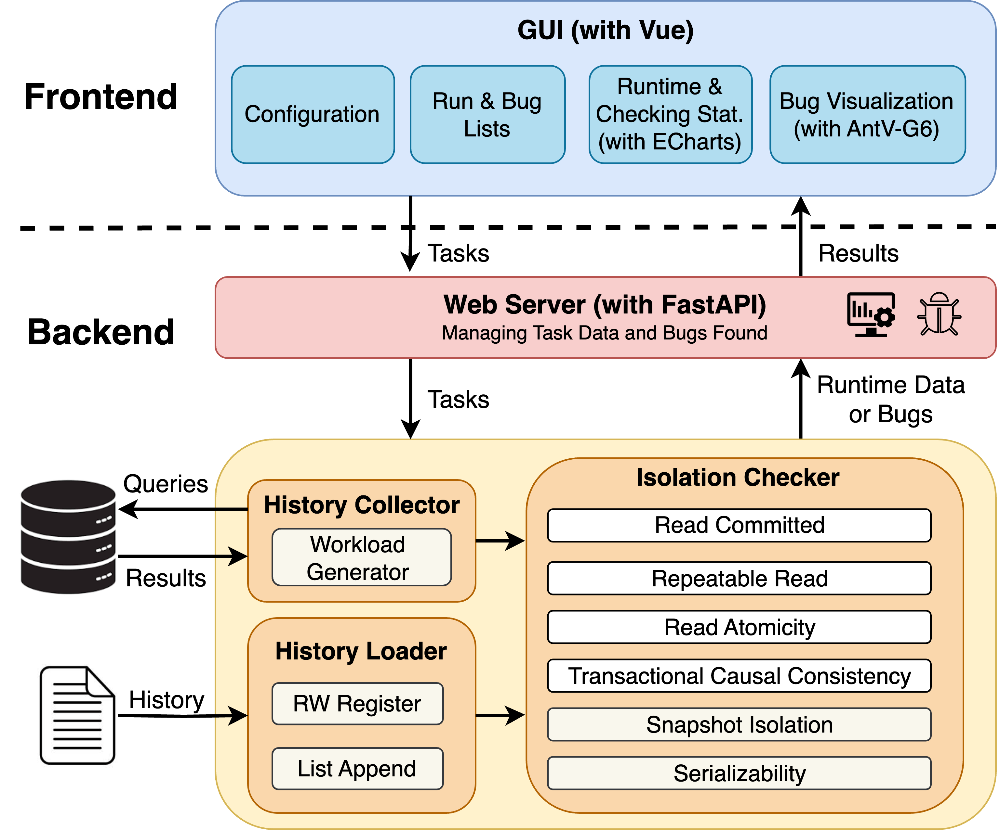

# IsoVista

IsoVista is a black-box database isolation checking system. It generates or loads transaction histories, executes workloads on supported databases, checks histories with multiple algorithms, and visualizes counterexamples and runtime profiles.

## Current capabilities

- Check read-write register and list-append histories with integrated C4, PolySI, VeriStrong, Viper, and Elle-based checkers.
- Check configured RC, RR, RA, TCC, SI, and SER specifications, subject to each checker's model and assumptions.
- Collect histories through JDBC collectors for MySQL, PostgreSQL, MariaDB, and H2.
- Upload existing histories, inspect dependency graphs, and download bug artifacts.
- Monitor runtime information and checker stage profiles through the Web UI.

Feature support depends on the selected history model and external runtime. See [ROADMAP.md](ROADMAP.md) for exact registration names, current limitations, and verification status.

## Architecture



## Quick start with Docker

```bash
docker pull ghcr.io/hengxin/isovista:main
docker run --name IsoVista -p 8080:8080 -p 8000:8000 --rm -d ghcr.io/hengxin/isovista:main
```

Open `http://127.0.0.1:8080`. The frontend uses `http://127.0.0.1:8000/` as its default backend address. These commands use the published upstream image; to run this exact checkout, build it with `docker build -t isovista .` and substitute `isovista` for the image name.

For a remote deployment, set the backend URL visible to the browser:

```bash
docker run --name IsoVista \
  -e VITE_BACKEND_URL=http://<server-address>:8000/ \
  -p 8080:8080 -p 8000:8000 --rm -d \
  ghcr.io/hengxin/isovista:main
```

Use a dedicated test database. Existing collectors create and remove the `dbtest` database or its tables.

## Local development

Prerequisites:

- JDK 11 for Java builds and tests
- Node.js 20 and npm for the frontend
- Python 3.10 with `backend/requirements.txt` (the CI baseline)
- Additional native or external dependencies for MonoSAT, VeriStrong, Viper, Elle, and database integration tests

The verified commands, startup order, configuration keys, and current environment constraints are maintained in [ROADMAP.md](ROADMAP.md). Frontend-specific commands are in [frontend/README.md](frontend/README.md). Local MySQL and PostgreSQL Compose files are documented in [scripts/standalone/README.md](scripts/standalone/README.md).

## History input

### Read-write register

Text operations use `r/w(key, value, session id, txn id)`:

```text
w(1,0,0,0)
w(2,0,0,0)
w(1,1,1,1)
r(2,0,1,2)
```

### List-append

IsoVista can load Jepsen/Elle-style list-append histories. See the [Jepsen history format](https://github.com/jepsen-io/history) and the existing examples under `examples/histories/`.

## Usage and extension guides

- [Contributing guide](CONTRIBUTING.md): development workflow, change expectations, and pull-request checklist.
- [Use cases](docs/use-cases.md): analyze an existing SI history and compare SI checkers.
- [How to check a new database](docs/how-to-check-a-new-database.md): current collector extension steps.
- [How to implement a new checker](docs/how-to-implement-a-new-checker.md): current checker contract and registration.
- [Target-state designs](docs/plans/README.md): proposed designs, not implemented features.
- [Single-person implementation roadmap](docs/plans/11-roadmap.md): prioritized stages and acceptance criteria.

## Known limitations

- The backend uses a serial queue and shared `config.properties` and `current/` paths; concurrent runs are not isolated.
- Native libraries and external checkers require a compatible runtime. A successful frontend build does not prove that the full checking pipeline works.
- Large workloads can exhaust local resources. Start with small histories and record timeout, OOM, and execution errors separately from semantic verdicts.

## Related projects

- [PolySI](https://github.com/amnore/PolySI)
- [Viper](https://github.com/Khoury-srg/Viper)
- [Elle](https://github.com/jepsen-io/elle)
- [elle-cli](https://github.com/ligurio/elle-cli)
