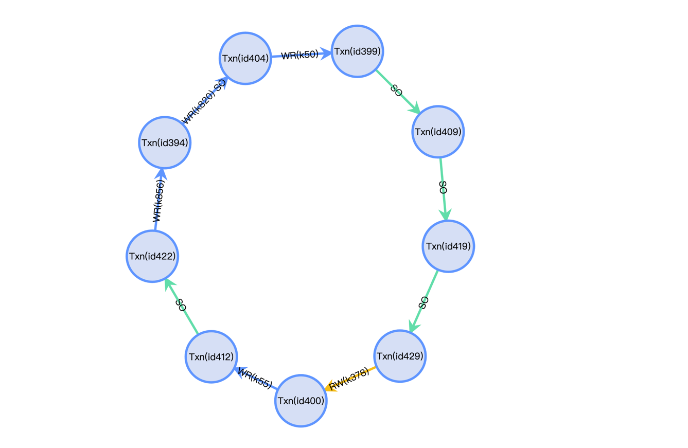
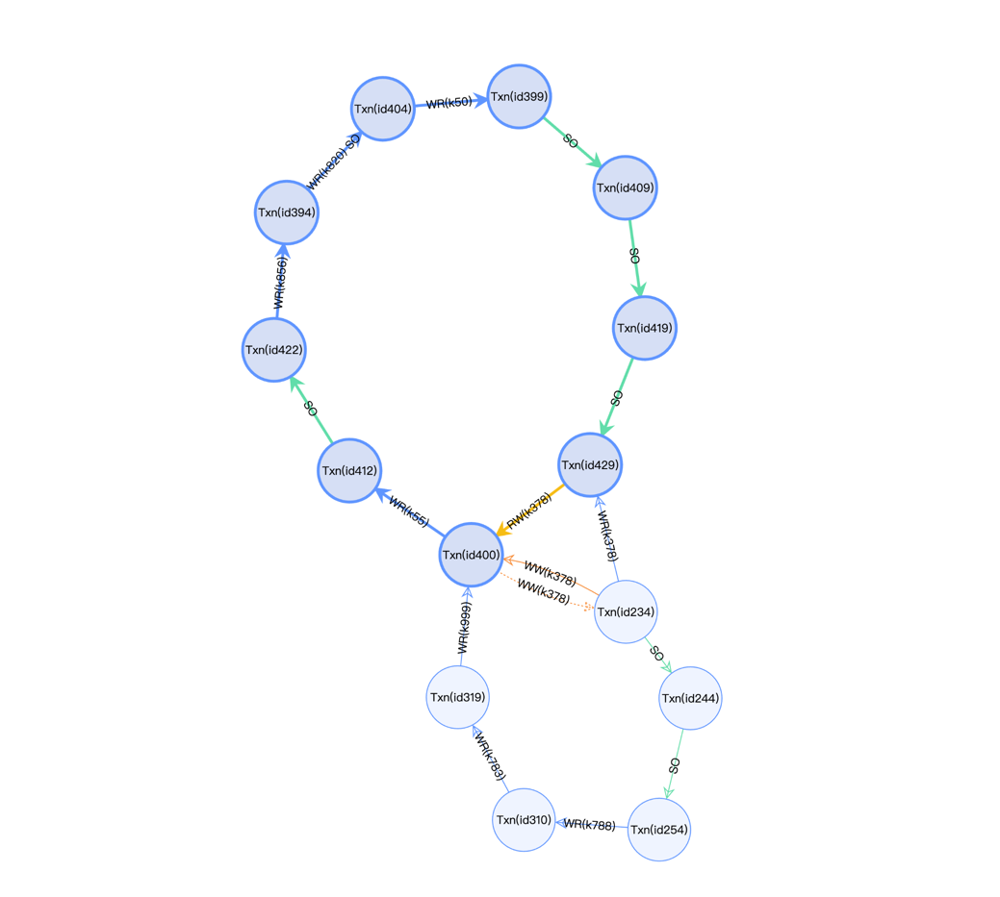
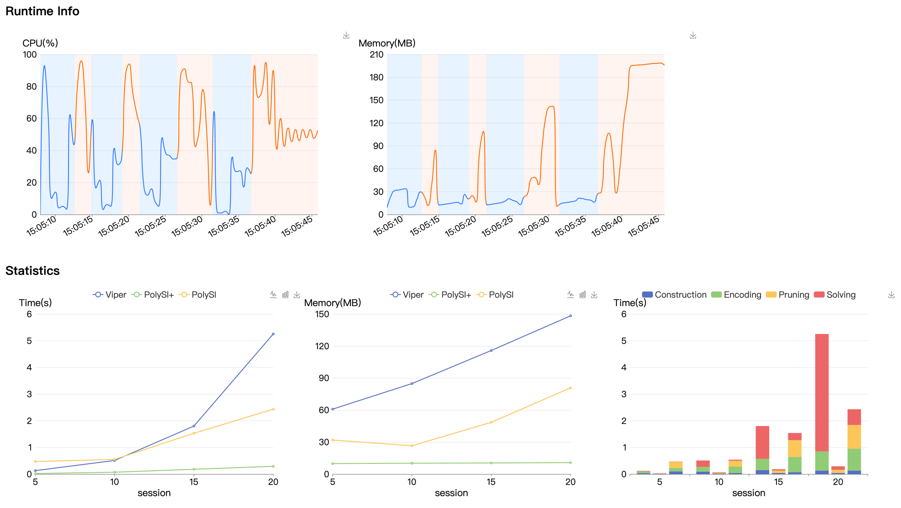

# Use Cases

Start IsoVista locally by following the [root README](../README.md). Use your own dedicated test database and credentials; no public server or predeployed database is required for these examples.

## Analyze an existing SI history

The repository includes [`examples/histories/dgraph_si.txt`](../examples/histories/dgraph_si.txt), a previously collected read-write register history containing an SI violation.

1. In **Workload Setting**, enable **Skip Generator** and select **Read-Write Registers (Text)**.
2. Upload `dgraph_si.txt`.
3. In **Checker Setting**, select **Snapshot Isolation (PolySI)** and start the run.
4. Open the resulting bug from **Bug Table** and select **View**.

The counterexample contains WR, SO, and RW edges. WR and SO are known edges; the RW edge is derived. Colors and styles distinguish their roles in the displayed graph.

Right-click `RW(k378)` and choose **Expand** to inspect its derivation:

The expanded graph includes the supporting WW and WR dependencies. The alternative WW direction is pruned because the existing SO and WR paths already determine the relevant order. Use the original history and downloaded DOT file when citing or further analyzing the result.

## Compare SI checkers on the same history

1. Load the same history as above; do not regenerate a different workload for each checker.
2. Select PolySI, Viper, and PolySI+ in **Checker Setting**.
3. After the run, compare verdicts, total time, stage profiles, and runtime information.

For a rigorous comparison, also record the history hash, timeout, memory limit, software versions, and machine environment. Different counterexample graphs do not necessarily imply different verdicts, and timeout or execution error must not be counted as accept or reject. The complete protocol is specified in [Performance Analysis](plans/09-performance-analysis.md).

## Execute a generated workload against a local database

1. Start a supported test database, for example with [the standalone Compose files](../scripts/standalone/README.md).
2. Enter its JDBC URL, credentials, collector type, and database isolation level.
3. Configure a small workload and one compatible checker, then start the run.
4. Inspect logs and artifacts before increasing the workload size.

Record the database isolation level and checker specification separately; they are not interchangeable settings. Use only a disposable test database because collectors may create, clear, or drop `dbtest` objects.
